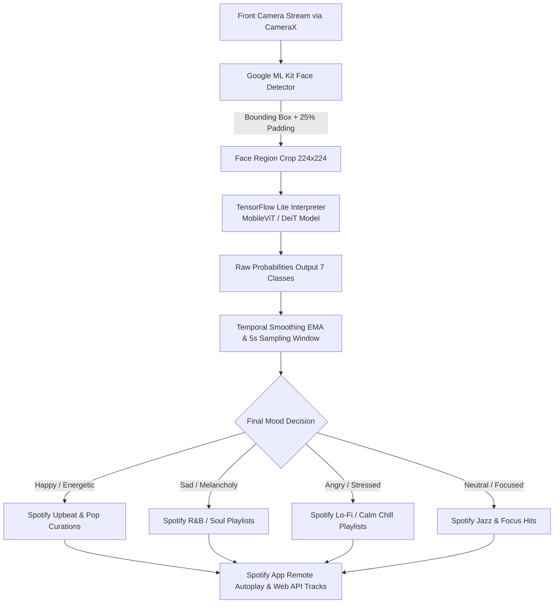

# 🎵 EmoMusic — Real-Time Facial Emotion Recognition & Adaptive Music Player

[-3DDC84?logo=android&logoColor=white)](#)
[](#)
[](#)
[](#)
[](#)
[](#)

**EmoMusic** is an intelligent Edge-AI Android application that analyzes facial expressions in real-time through the device's front camera, predicts the user's current mood using a lightweight Vision Transformer (ViT) on-device deep learning model, and automatically curates and plays matching music tracks and playlists via Spotify.

---

## 🌟 Key Features

- **⚡ 100% On-Device Edge AI Inference**: Powered by TensorFlow Lite and Google ML Kit. Zero cloud latency and complete user privacy—no video or camera frames are ever sent over the network.
- **🧠 Research-Grade Facial Emotion Classifier**: Detects **7 distinct emotional states**: *Angry, Disgust, Fear, Happy, Sad, Surprise, and Neutral*.
- **🎯 Temporal Smoothing & Jitter Reduction**: Features an interactive 5-second sampling countdown (`ScanCountdownView`) using an Exponential Moving Average (EMA) and majority voting filter to prevent noisy, erratic frame-by-frame fluctuations.
- **📊 Real-Time Confidence Bar Visualizer**: Displays live probability distributions for all 7 emotions as the model analyzes facial features.
- **🎧 Seamless Spotify Ecosystem**:
  - Automatic playback trigger using Spotify App Remote SDK.
  - Dynamic playlist recommendations and track search via Spotify Web API (Retrofit + OkHttp).
  - Modern bottom sheet track explorer (`MusicBottomSheet`) with album art loaded via Glide.
- **🌙 Modern Dark-Themed UI**: Built using Material Design Components, ViewBinding, and custom vector drawables.

---

## 🏗️ System Architecture



---

## 🔬 Machine Learning Pipeline

The project includes the complete deep learning training pipeline in [`Emotin_Final.ipynb`](Emotin_Final.ipynb):

1. **Dataset**: Trained and evaluated on the **FER-2013** dataset (Face Expression Recognition).
2. **Model Architecture**:
   - DeiT-Small / MobileViT backbone fine-tuned for high-speed edge deployment.
   - Cross-Modal Geometric Embedder combining raw pixel data with facial landmarks / FACS action units.
   - Optimized for mobile inference with FP32/FP16 quantization.
3. **Conversion**: Exported to TensorFlow Lite (`mobilevit_emotion.tflite` / `emotion_model.tflite`) placed in `app/src/main/assets/`.

---

## 📂 Project Structure

```
musicc/
├── app/
│   ├── libs/
│   │   └── spotify-app-remote-release-0.8.0.aar   # Spotify Remote SDK
│   └── src/
│       ├── main/
│       │   ├── assets/
│       │   │   ├── mobilevit_emotion.tflite       # Edge AI TFLite Model
│       │   │   └── emotion_model.tflite
│       │   ├── java/com/eis/emomusic/
│       │   │   ├── EmotionClassifier.java         # TFLite inference engine
│       │   │   ├── EmotionResult.java             # Emotion data model
│       │   │   ├── MainActivity.java              # CameraX, ML Kit, UI flow
│       │   │   ├── MusicBottomSheet.java          # Bottom sheet track list
│       │   │   ├── ScanCountdownView.java         # Custom countdown ring widget
│       │   │   ├── SpotifyManager.java            # Spotify Auth & Web API
│       │   │   ├── SpotifyTrack.java              # Track entity model
│       │   │   └── TrackAdapter.java              # RecyclerView track adapter
│       │   ├── res/                               # Layouts, themes, colors
│       │   └── AndroidManifest.xml
│       └── test/                                  # Unit tests
├── Emotin_Final.ipynb                             # Model training & export notebook
├── build.gradle.kts                               # Root build configuration
└── settings.gradle.kts
```

---

## 🚀 Getting Started & Setup

### Prerequisites
- **Android Studio**: Ladybug / Koala (or newer)
- **Android Device or Emulator**: Android 8.0 (API level 24) or higher with camera support
- **JDK**: Java 11 or higher
- **Spotify App**: Installed and logged in on the test device

### 1. Clone the Repository
```bash
git clone https://github.com/Aishwarya095/EmoMusic.git
cd EmoMusic
```

### 2. Configure Spotify Developer Dashboard
1. Go to the [Spotify Developer Dashboard](https://developer.spotify.com/dashboard) and create an app.
2. In your app settings, configure:
   - **Redirect URI**: `emomusic://callback`
   - **Package Name**: `com.eis.emomusic`
   - **SHA-1 Fingerprint**: Add your debug keystore SHA-1 fingerprint (run `./gradlew signingReport` to find it).
3. If using your own Client ID, replace `CLIENT_ID` in `SpotifyManager.java`:
   ```java
   private static final String CLIENT_ID = "YOUR_SPOTIFY_CLIENT_ID";
   ```

### 3. Build & Run
Open the project in Android Studio and click **Run** (`Shift + F10`), or build from terminal:
```bash
./gradlew assembleDebug
```
The APK will be generated at `app/build/outputs/apk/debug/app-debug.apk`.

---

## 🛠️ Tech Stack & Dependencies

- **Camera & Vision**:
  - `androidx.camera:camera-camera2:1.3.1` (CameraX lifecycle-aware camera capture)
  - `com.google.mlkit:face-detection:16.1.6` (On-device face landmark & bounding box detection)
- **Machine Learning**:
  - `org.tensorflow:tensorflow-lite:2.14.0`
  - `org.tensorflow:tensorflow-lite-support:0.4.4`
- **Networking & Music**:
  - Spotify App Remote SDK (`spotify-app-remote-release-0.8.0.aar`)
  - Spotify Android Auth (`com.spotify.android:auth:2.1.0`)
  - `com.squareup.retrofit2:retrofit:2.9.0` (Spotify Web API)
  - `com.squareup.okhttp3:logging-interceptor:4.12.0`
- **UI & Utilities**:
  - Material Design Components (`com.google.android.material:material:1.11.0`)
  - `com.github.bumptech.glide:glide:4.16.0` (Album cover image loading)

---

## 📜 License

This project was developed as a 3rd-year 6th-semester engineering project and is distributed under the MIT License. See [LICENSE](LICENSE) for details.

